# Park Informatique - IT Equipment Management System

## Overview

Park Informatique is a web-based application designed to facilitate the management and monitoring of IT equipment within an organization.

The platform provides role-based access, equipment tracking, incident reporting, needs management, notifications, and AI-assisted features through a modern web interface.

This repository is a **showcase of the project**. It contains screenshots and documentation for demonstration purposes. The original source code is not included.

## Main Features

* User authentication and account creation.

* Password recovery and OTP verification.

* Role-based dashboards and access control.

* IT equipment management.

* Breakdown and incident reporting.

* Equipment needs management.

* Notifications.

* AI assistant features.

* Light mode interface.

## User Roles

* **Admin:** General system administration.

* **Responsable:** Management and monitoring.

* **Consultant:** Notifications and application access.

* **Consultant Materiel:** Equipment-related needs and breakdown management.

## Technologies Used

* **Backend:** Laravel 12

* **Frontend:** React 18

* **Database:** MySQL

* **Styling:** Tailwind CSS and Material UI

* **Authentication:** JWT

* **Development Tools:** Vite

## Screenshots

### 1. Home Page

### 2. Authentication

| Login                           | Login - Light Mode                               |

| ------------------------------- | ------------------------------------------------ |

| 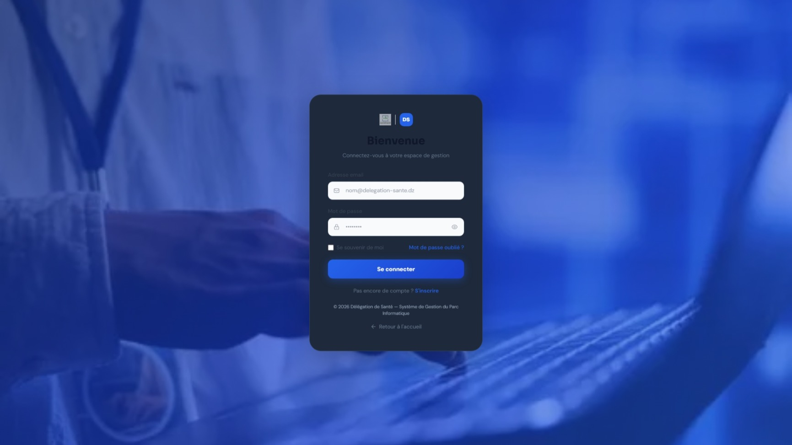 | 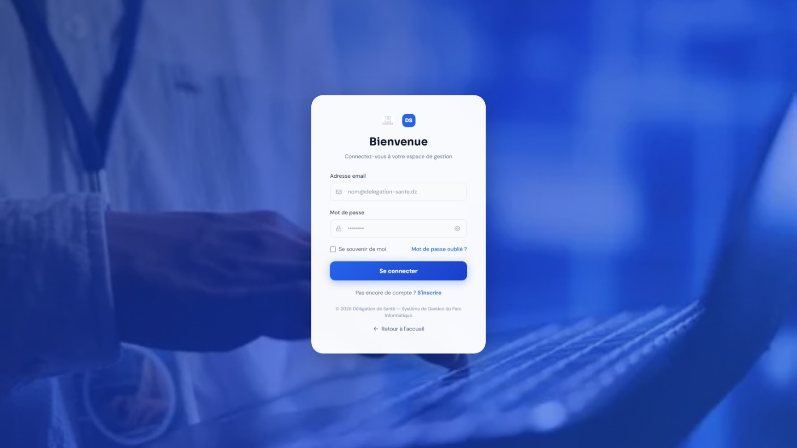 |

| Forgot Password                                     | OTP Verification            | Registration                              |

| --------------------------------------------------- | --------------------------- | ----------------------------------------- |

| 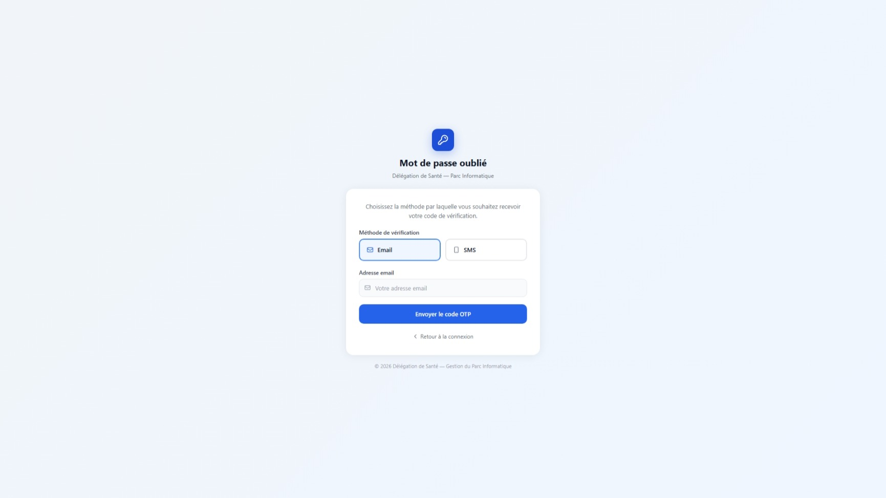 | 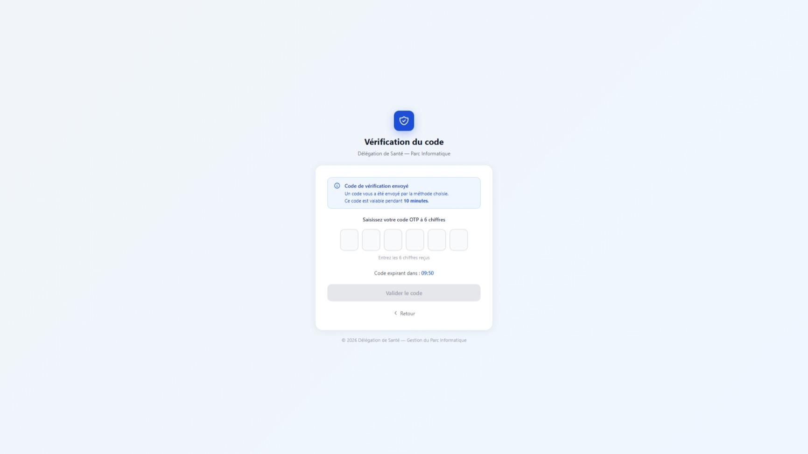 | 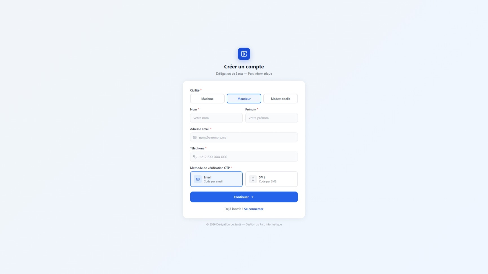 |

### 3. Admin Dashboard

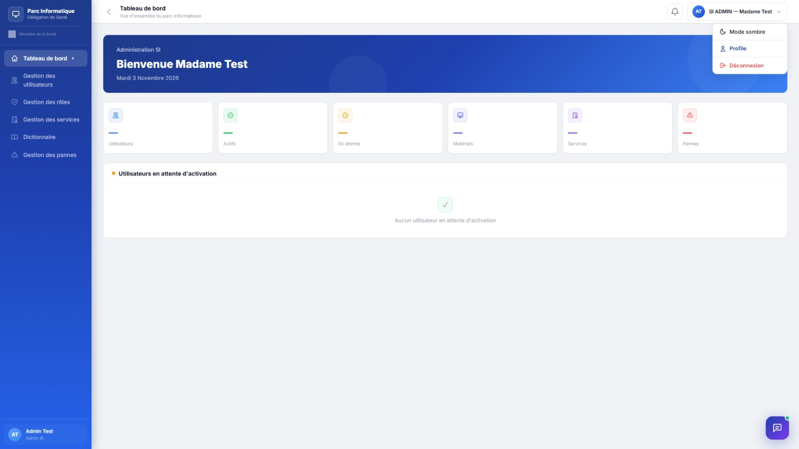

### 4. AI Features

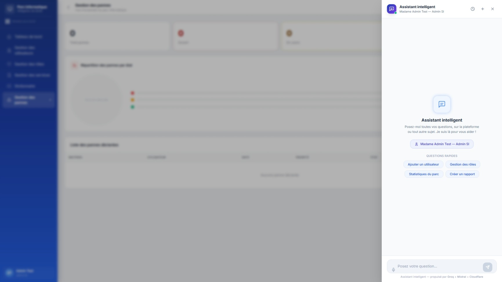

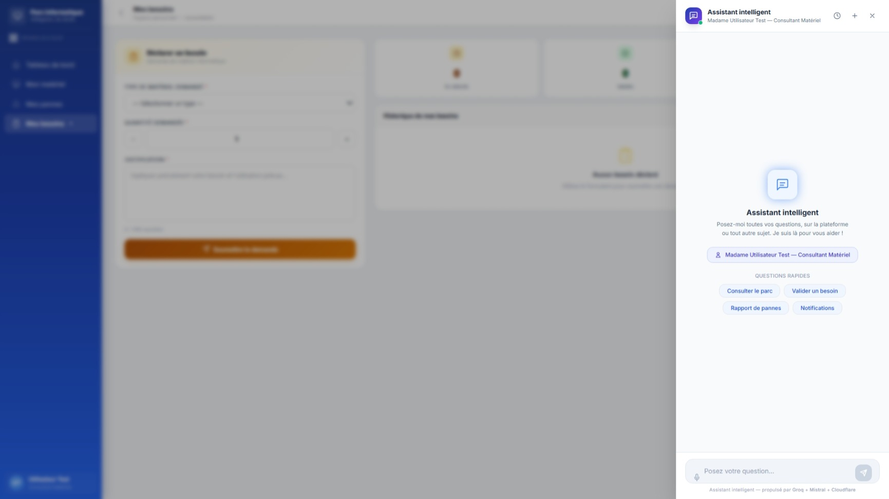

### 5. Responsable Dashboard

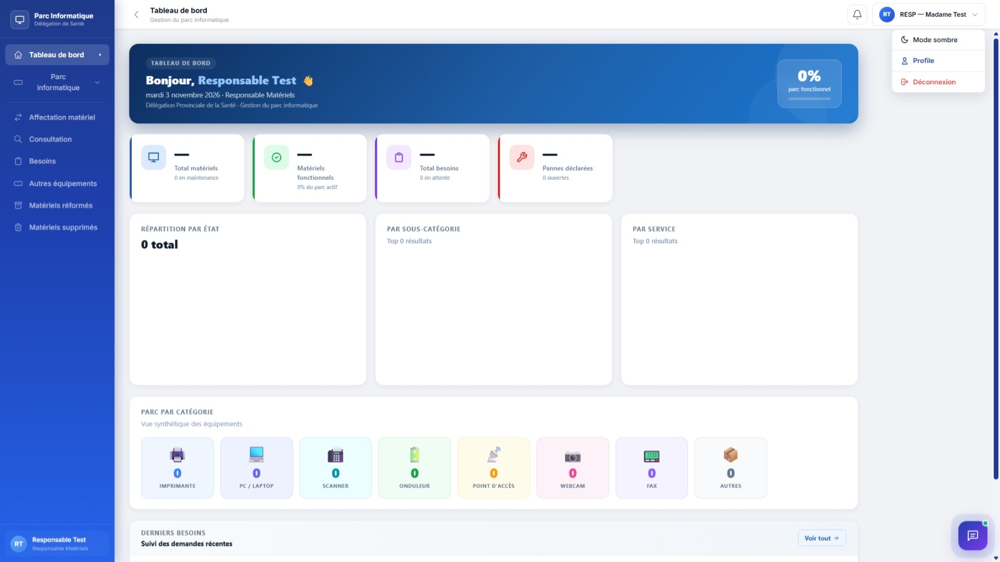

### 6. Consultant Notifications

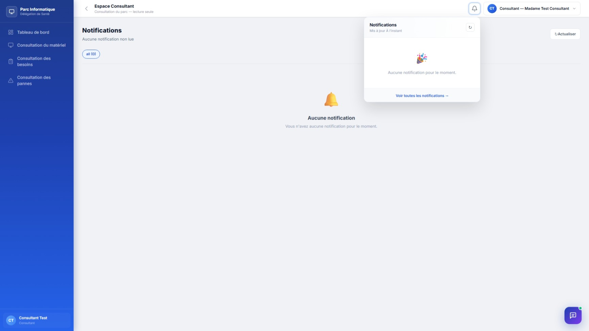

### 7. Consultant Materiel

| Equipment Breakdowns                                      | Equipment Needs                                       |

| --------------------------------------------------------- | ----------------------------------------------------- |

| 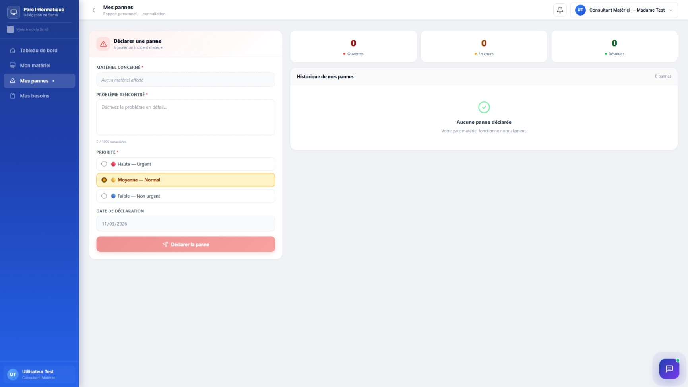 | 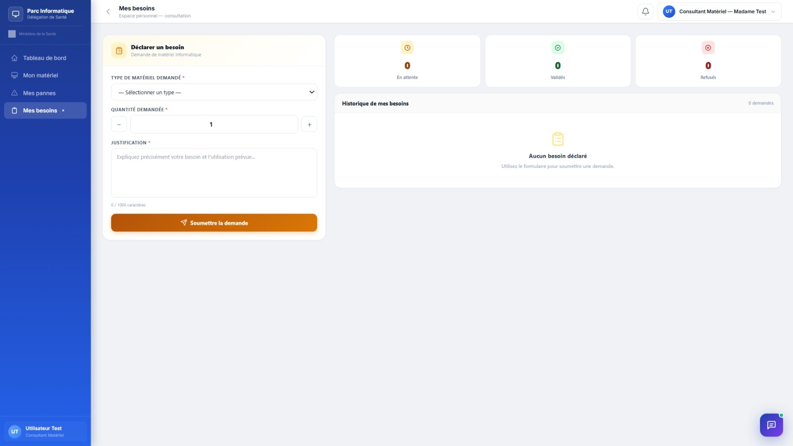 |

## Project Context

This application was developed as a **Final Year Project (PFE)** during the Web Full Stack Development program at OFPPT.

It was a collaborative project involving the design and development of a web application for IT equipment management.

## Repository Purpose

This repository is intended for portfolio and demonstration purposes only.

It showcases selected application interfaces and project documentation without publishing the original source code.

---

**Developed as part of a collaborative Final Year Project - 2025/2026.**

